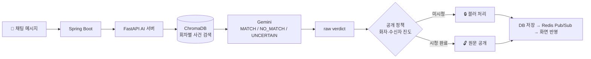
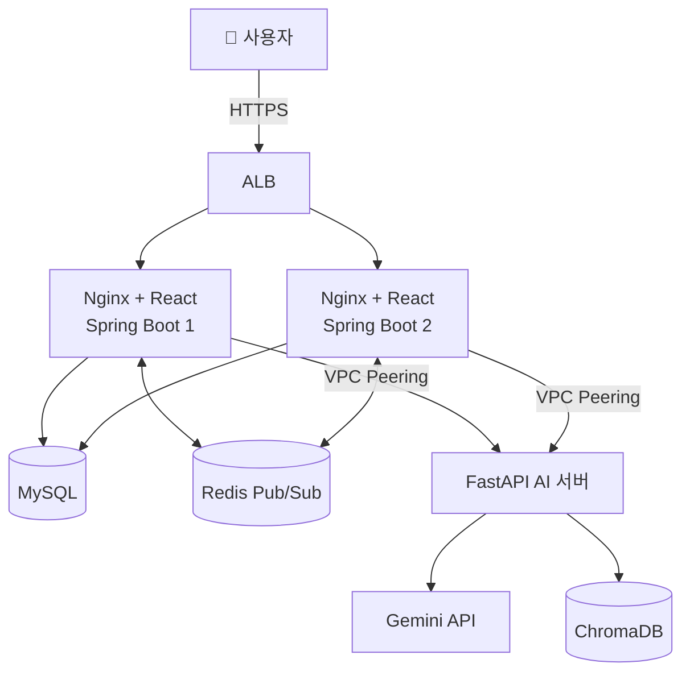

<div align="center">

<!-- TODO: 로고/배너 이미지 → docs/images/banner.png -->


# 🔒 SPOILOCK

### 시청 진도 기반 AI 스포일러 보호 드라마 커뮤니티

**시청 경험은 보호하고, 소통은 자유롭게.**

[](https://react.dev)
[](https://vitejs.dev)
[](https://spring.io/projects/spring-boot)
[](https://fastapi.tiangolo.com)
[](https://www.mysql.com)
[](https://redis.io)
[](https://aws.amazon.com)

**🌐 [spoilock.watch](https://spoilock.watch)**

</div>

<br />

<!-- TODO: 스포일러 블러 처리 데모 GIF → docs/images/demo.gif -->
<div align="center">
  
</div>

<br />

## 📌 프로젝트 소개

| 항목 | 내용 |
| --- | --- |
| **프로젝트명** | SPOILOCK (스포일러 걱정 없는 드라마 커뮤니티) |
| **팀명** | Spo_light:0 |
| **기간** | 2026.10.19 ~ 2026.11.16 (4주) |
| **교육기관** | 한국정보교육원 · 2차 팀 프로젝트 |

OTT와 온라인 영상 콘텐츠 이용이 늘면서 작품에 대한 감상을 나누는 커뮤니티와 실시간 채팅도 활발해졌지만, 아직 보지 않은 회차의 내용이 그대로 노출되는 문제가 반복됩니다.

SPOILOCK은 **영상 시청 · 실시간 채팅 · 커뮤니티**를 하나의 서비스로 통합하고, **AI가 작품의 사건을 이해해 사용자별 시청 진도에 맞게 메시지를 공개**합니다.

<br />

## 💡 왜 만들었나요?

| 기존 방식 | 한계 |
| --- | --- |
| 일반 커뮤니티 | 게시글·댓글을 읽는 순간 결말과 반전이 노출됩니다. |
| 실시간 채팅 | 시청 시점은 사람마다 다른데 대화는 실시간으로 흘러갑니다. |
| 키워드 필터 | 작품의 사건과 맥락을 이해하지 못해 같은 단어도 정확히 구분하지 못합니다. |

> **문제 정의** · 콘텐츠를 막는 것이 아니라, **사용자별로 안전하게 공개**해야 한다.

<br />

## 🎯 핵심 시나리오

같은 메시지도 **보는 사람의 진도에 따라** 다르게 보입니다.

> 💬 **"3화에서 범인이 밝혀졌어!"** (작성자는 3화까지 시청)

| 수신자 | 상태 | 결과 |
| --- | --- | --- |
| **A** · 1화까지 시청 | 🔒 원문 보호 | 아직 보지 않은 사건이라 블러 처리 |
| **B** · 3화까지 시청 | 🔓 열람 가능 | 이미 본 사건이라 원문 공개 |
| **C** · 시청 정보 없음 | 🔒 보수적 처리 | 진도를 알 수 없으면 원문 보호 |

AI는 **"이 발언이 몇 화의 사건인지"**만 판정하고, **공개 여부는 서비스 정책이 사용자별 진도로 결정**합니다.

<br />

## ✨ 주요 기능

### 👤 사용자

| 기능 | 설명 |
| --- | --- |
| 🔐 **회원/인증** | 이메일 인증 회원가입, 일반·Kakao 로그인, JWT(HttpOnly 쿠키) 인증, 토큰 갱신 |
| 🎬 **작품 · 영상** | 작품 목록/상세, 회차별 영상 재생, 이전·다음 회차 이동, 이어보기 |
| 📈 **시청 진도 · 별점** | 작품별 진도 직접 설정, 자체 영상 작품은 진도 하향 제한, 별점 등록/수정/삭제 |
| 💬 **실시간 채팅** | WebSocket(STOMP) 기반 토론방 · 자유방 · 초대코드 비밀방, 방장 위임, 빈 방 자동 삭제 |
| 🛡️ **스포일러 보호** | AI 판정 + 화자·수신자 진도 비교로 메시지 블러 처리, 이미지(장면·자막)도 보호 |
| 📝 **커뮤니티** | 게시글·댓글 실시간 반영, 사진 드래그 앤 드롭·미리보기, 팔로우/팔로잉, 전체·팔로워 공개 |
| 🔔 **신고 · 알림** | 메시지/게시글 신고, 실시간 알림, 읽지 않은 알림 수 |
| 🙋 **마이페이지** | 시청 목록(전체/시청 중/완주), 작품별 진도, 참여 중인 채팅방 |

### 🛠️ 관리자

| 기능 | 설명 |
| --- | --- |
| 📺 **콘텐츠 관리** | 작품·회차·영상·자막 등록, 공개/숨김, 삭제 시 관련 데이터 보관 |
| 🤖 **AI 분석 관리** | 영상·자막 업로드, 분석 진행/완료/실패 상태 표시, 추출 사건 검토, 업로드 중 이탈 경고 |
| 📊 **모니터링** | AI 판정 이력, 원문·작성자·채팅방·매칭 회차, AI 원본 판정과 최종 공개 정책 구분, 단계별 처리 추적 |

<br />

## 🤖 AI 스포일러 판정

> 모델을 다시 학습시키는 대신, **RAG**로 작품 사건 정보를 검색해 판정 근거로 제공합니다.



1. **작품 지식 구성** · SRT 자막과 영상 STT에서 사건을 추출해 회차별로 ChromaDB에 색인
2. **사용자 발언 판정** · 대화 맥락과 후보 사건을 검색하고 Gemini가 판정
3. **공개 정책 반영** · 화자·수신자의 시청 진도로 최종 공개 여부를 결정

> 🧩 AI 서버는 별도 저장소로 관리합니다 → **[spoilock-ai](https://github.com/plkj1032/spoilock-ai)** <!-- TODO: 실제 저장소 주소로 수정 -->

<br />

## 🏗️ 시스템 아키텍처

<!-- TODO: 인프라 토폴로지 이미지 → docs/images/topology.png -->
<div align="center">
  
</div>



- 웹 요청 · 실시간 메시지 · AI 판정을 **서버 역할별로 분리**해 장애 위치를 구분합니다.
- Spring Boot 2대를 서로 다른 가용 영역에 배치하고 ALB 상태 검사로 트래픽을 분산합니다.
- 서버가 여러 대여도 STOMP 이벤트를 **Redis Pub/Sub**으로 공유해 실시간 채팅이 끊기지 않습니다.

<br />

## 🧰 기술 스택

| 영역 | 기술 |
| --- | --- |
| **Frontend** | React 19, Vite 8 |
| **Backend** | Java 21, Spring Boot 4.1, Spring Security, JWT, OAuth 2.0 (Kakao), Spring Data JPA, QueryDSL, Flyway |
| **Realtime** | WebSocket, STOMP, Redis Pub/Sub |
| **AI** | Python, FastAPI, Gemini API, ChromaDB, multilingual-e5-small (임베딩) |
| **Database** | MySQL 8.0, Redis 7.4 |
| **Infra** | AWS (VPC, EC2, ALB, Route 53, ACM, S3, SSM, IAM), Docker, Nginx |
| **CI/CD** | GitHub Actions → S3 → SSM |
| **Collaboration** | GitHub, IntelliJ IDEA, VS Code, MySQL Workbench |

<br />

## 🔥 기술적 도전과 해결

<details>
<summary><b>1. LLM의 불안정한 판정 → 역할 분리</b></summary>

<br />

등장인물 이름만 나와도 스포일러로 판정하거나, 프롬프트 예시의 이름이 실제 판정에 섞이는 문제가 있었습니다. 프롬프트 문장을 고치는 대신 **구조를 바꿨습니다.**

- LLM: "사실/추측/단순 반응" 구분과 "관련 사건" 판단만 담당
- 코드·정책: 최종 스포일러 여부와 공개 회차 결정
- 질문에 대한 답("ㅇㅇ"), 여러 번에 나눠 보낸 문장, 대사 인용은 **직전 대화와 자막을 함께 비교**해 판정

</details>

<details>
<summary><b>2. 장애 시에도 스포일러가 노출되지 않는 설계</b></summary>

<br />

- 분석에 실패하면 **원문을 가린 채 재시도**
- 단계별 처리 시간을 로그로 남겨 지연 원인이 외부 LLM 응답임을 수치로 확인
- 중단된 작업 복구, 실패 재시도, 본문 수정 버전 보호

</details>

<details>
<summary><b>3. 추측이 맞다는 단서가 되지 않도록</b></summary>

<br />

화자가 시청하지 않은 회차에 대한 발언은 **일치 여부만으로 차단하지 않도록** 설계했습니다. 차단 표시 자체가 "그 추측이 맞다"는 힌트가 되는 상황을 막기 위해서입니다.

</details>

<details>
<summary><b>4. 비동기 AI 분석의 정합성</b></summary>

<br />

`PENDING → PROCESSING → COMPLETED / FAILED → RETRY` 상태 전이를 두고, **트랜잭션 커밋 이후**에 비동기 분석을 시작해 롤백된 글이 분석되는 일을 방지했습니다.

</details>

<details>
<summary><b>5. 저작권을 지키는 시연 콘텐츠</b></summary>

<br />

기존 영상물의 저작권을 준수하기 위해 시연용 웹드라마를 직접 제작해 서비스에 적용했습니다.

</details>

<br />

## 🚀 시작하기

### Prerequisites

- Java 21
- Node.js (LTS)
- MySQL 8.0, Redis 7.4
- AI 서버 ([spoilock-ai](https://github.com/plkj1032/spoilock-ai)) <!-- TODO: 주소 확인 -->

### 환경 변수

```bash
cp .env.example .env
# .env 파일을 열어 DB, Redis, JWT, Kakao, AI 서버 주소 등을 설정합니다.
```

### Backend

```bash
cd backend
./gradlew bootRun   # TODO: 빌드 도구(Gradle/Maven)에 맞게 수정
```

### Frontend

```bash
cd frontend
npm install
npm run dev
```

<br />

## 📁 폴더 구조

```
spoilock
├── .github/workflows   # GitHub Actions (CI/CD)
├── backend             # Spring Boot 서버
├── frontend            # React 클라이언트
├── deploy              # 배포 스크립트
├── .env.example
└── README.md
```

<br />

## 📅 프로젝트 일정

**2026.10.19 ~ 2026.11.16** (WBS 기준 4주)

<!-- TODO: WBS 이미지가 있다면 추가 → docs/images/wbs.png -->

<br />

## 👥 팀원 · Spolight:0

<div align="center">

| 백기완 (팀장) | 장준호 | 최서연 |
| :---: | :---: | :---: |
| [@plkj1032](https://github.com/plkj1032) | [@ohnuj](https://github.com/ohnuj) | [@Seo-Yeon-Choi](https://github.com/Seo-Yeon-Choi) |
| JWT · Kakao 로그인<br/>작품 등록 · 진도 설정<br/>게시글 · 채팅 모니터링<br/>**AWS 인프라 · 배포** | 실시간 채팅 · 채팅방<br/>영상 시청 · 드라마 상세<br/>마이페이지 · 신고/팔로우 알림<br/>인증 상태 · 연결 복구 | **AI 스포일러 판정 서버**<br/>FastAPI · Gemini · ChromaDB<br/>AI 서버 EC2 배포<br/>Spring 공개 정책 연동 |

</div>

<br />

<div align="center">

**한국정보교육원 · 현업에서 바로 통하는 자바 풀스택 & 생성형 AI 서비스 개발 기업 프로젝트**

</div>
